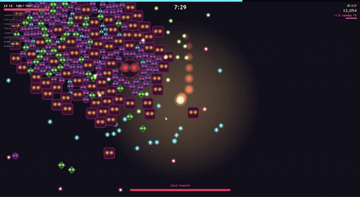
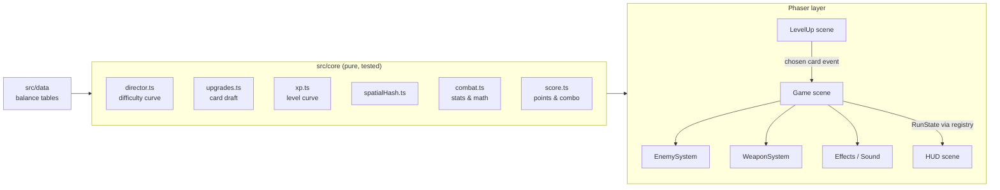

# 🏮 Hollowlight

[](https://game.hollowlight.workers.dev)
[](https://github.com/vishnu2007dev/hollowlight/actions/workflows/ci.yml)
[](LICENSE)


**A tiny arena survivor for the browser.** You're a lantern spirit holding back an endless tide of shadow creatures. Survive until dawn: a quick 5-minute run or the full 10.

Built from scratch with **Phaser 3 + TypeScript**. No art or audio files: every texture is drawn in code and every sound is synthesised with the Web Audio API.

**[▶ Play it in your browser](https://game.hollowlight.workers.dev)**

[](https://game.hollowlight.workers.dev)

---

## Features

- **4 auto-firing weapons**, each with 5 levels: Lantern Bolt, Orbit Blades, Flare Nova and Ember Trail
- **6 passive upgrades** chosen from a weighted 3-card draft on every level-up
- **4 enemy types plus a boss**, each with its own behaviour (chasers, fast runners, tanky brutes, ranged spitters that strafe)
- **A score system that rewards how you play**:
  - every kill scores points, multiplied by a **combo** that grows as you chain kills (up to ×4) and resets if you get hit or stop killing for 2.5 s
  - rare **pink wisps** appear on screen worth 250 points (times your combo), but they fade in 9 s and ignore your magnet, so you have to dive in and grab them
  - surviving earns 10 points a second, reaching dawn adds a big bonus, and Easy scores ×0.6 so high scores compare fairly
- **Easy and Normal modes**: Easy spawns fewer, weaker enemies and you take 40% less damage; high scores are tracked per mode and run length
- **5 or 10 minute runs**: the short run plays the first half of the difficulty curve and ends with one boss at 4:00; the full run has bosses at 5:00 and 9:00
- **A difficulty director** that phases in enemy types and scales spawn rate and HP over the run
- **300+ enemies on screen at 60 fps**, using object pooling and a custom spatial hash
- **Feel**: hit flashes, particles, damage numbers, screen shake and synthesised sound effects
- **Plays anywhere**: keyboard on desktop, a floating virtual joystick on touch screens, responsive layout
- **Share your score** from the results screen: the native share sheet on phones, a copied message with a link on desktop
- High scores, best times and settings saved in `localStorage`

## Controls

| Action | Keyboard | Touch / mouse |
| --- | --- | --- |
| Pick mode (menu) | ← / → | Tap Easy / Normal |
| Pick run length (menu) | ↑ / ↓ | Tap 5 min / 10 min |
| Move | WASD / Arrow keys | Press and drag anywhere |
| Pick upgrade | 1 / 2 / 3 | Tap a card |
| Pause | Esc / P | (auto-pauses when the tab loses focus) |
| Share score (results screen) | S | Tap **Share score** |
| FPS counter | F | |

## Run it locally

```bash
git clone https://github.com/vishnu2007dev/hollowlight.git
cd hollowlight
npm install
npm run dev
```

| Script | What it does |
| --- | --- |
| `npm run dev` | Dev server with hot reload |
| `npm test` | Unit tests (Vitest) |
| `npm run lint` / `npm run typecheck` | ESLint / `tsc --noEmit` |
| `npm run build` | Production build to `dist/` |
| `npm run build:itch` | Build for itch.io and other game sites (no analytics) to `dist-itch/` |

## Architecture

The game rules are kept separate from the engine. Everything in `src/core/` is plain TypeScript with no Phaser imports, so it can be unit-tested in Node. The Phaser layer only renders and wires things together.



```
src/
  core/       game rules: RNG, XP curve, upgrade draft, spawn director, difficulty modes, scoring, spatial hash
  data/       balance tables for weapons, passives and enemies
  entities/   Player, Enemy, Projectile, Gem (lightweight, pooled)
  systems/    WeaponSystem, EnemySystem, Effects, Sound (Web Audio), Joystick, Save
  scenes/     Boot (procedural textures), Menu, Game, Hud, LevelUp, GameOver
tests/core/   unit tests for everything in src/core
```

### Engineering notes

- **Collisions without a physics engine.** Each frame, every enemy is inserted into a uniform-grid spatial hash. Targeting, weapon hits, enemy separation and contact damage are all radius queries against it, so nothing does an O(n²) scan.
- **Object pooling.** Enemies, projectiles and gems are recycled instead of being created and destroyed, so long runs don't stutter from garbage collection.
- **A data-driven director.** Difficulty is a pure function of elapsed time (`spawnPlan(t)`), which makes balance easy to tweak and test. One test asserts the game only ever gets harder.
- **Deterministic randomness.** A seeded PRNG (mulberry32) keeps the card-draft and spawn tests reproducible.
- **Locked down for hosting.** The production build ships a strict Content Security Policy (no inline scripts, no `eval`, no third-party connections), CI runs `npm audit` with least-privilege tokens and SHA-pinned actions, and package install scripts are disabled. See [SECURITY.md](SECURITY.md).
- **Zero assets.** Textures are generated with `Graphics.generateTexture` at boot, and sounds are oscillator and noise envelopes.

## Deployment

The build is plain static files in `dist/`, so it runs on any static host. The live version is on Cloudflare:

```bash
npm run build
npx wrangler deploy
```

[wrangler.jsonc](wrangler.jsonc) serves `dist/`, and [public/_headers](public/_headers) sends the security headers (CSP, no framing, HSTS and more). Every push and pull request runs [CI](.github/workflows/ci.yml): audit → lint → typecheck → test → build.

## Contributing

PRs are welcome. See [CONTRIBUTING.md](CONTRIBUTING.md) for setup and some good first ideas.

## License

[MIT](LICENSE)
